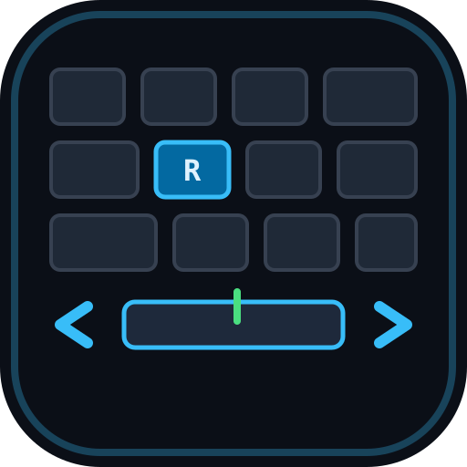

# Reactive-Typing

A high-performance, distraction-free typing practice application built for developers, students, and touch typists. Master code syntax, brackets, and developer ergonomics, or loosen up with finger warmups, guided progression lessons, and top-speed prose testing.



---

## Key Features

- **Developer Mode (Code Syntax Practice)**:
  - Real-world syntax and idioms across 8+ programming languages: TypeScript, JavaScript, Python, Rust, Go, SQL, HTML/CSS, and C++.
  - 3 customizable difficulty tiers: **Junior** (clean algorithms), **Mid** (destructuring & operators), and **Senior** (complex types, regex, nested delimiters).
- **Warmup Drills Mode**:
  - Home row agilities (`asdf jkl;`), high-frequency n-grams/digraphs (`th`, `er`, `in`, `st`), bracket pairs (`{ [ ( ) ] }`), extreme syntax operators (`===`, `!==`, `=>`, `??`), and number row drills.
- **Default Words & Timed Speed Bursts**:
  - High-frequency 100-word sprints and tech vocabulary with configurable timers (15s, 30s, 60s, or full text).
- **5-Stage Structured Curriculum**:
  - Guided touch-typing progression from resting home row to advanced punctuation and code brackets.
- **Computer Science Literature & Quotes**:
  - Excerpts from Alan Turing, Ada Lovelace, Donald Knuth, and the Unix Philosophy.
- **Custom Snippet Studio**:
  - Paste any custom code snippet, interview problem, or text file to practice immediately with automatic word and duration estimates.
- **Web Audio Mechanical Switch Synthesizer**:
  - Synthesizes realistic tactile switch acoustics using the browser's Web Audio API with zero external audio download latency:
    - **Clicky** (Cherry MX Blue profile: crisp leaf snap & bottom-out)
    - **Tactile** (Cherry MX Brown profile: soft rounded clack)
    - **Linear** (Cherry MX Red profile: smooth deep thock)
    - **Mute / Silent** toggle + granular volume slider.
- **Detailed Progress & Telemetry Analytics**:
  - Real-time rolling WPM, Raw WPM, Accuracy %, Consistency rating, and Caps Lock detection.
  - Second-by-second WPM trajectory pace graphs.
  - **Problem Keys Matrix**: Pinpoints the exact characters and symbols causing delays or errors.
  - Daily practice streak counter and historical session logging.
  - 1-click **JSON Export & Import** for backup and data portability.
- **Multi-Theme Switcher**:
  - **Dark Minimal**: Deep slate canvas (`#0B0F17`) with sky blue accents.
  - **Cyberpunk**: Obsidian surface (`#08090E`) with neon cyan and electric rose.
  - **Paper Light**: Editorial warm travertine (`#F8FAFC`) with crisp royal blue.
- **Cross-Platform Progressive Web App (PWA)**:
  - Web App Manifest (`manifest.json`) and service worker (`sw.js`).
  - Offline-first operation: practice anywhere without an active internet connection.
  - In-app install button with guided instructions for iOS Safari and Chromium.

---

## Keyboard Shortcuts

| Shortcut | Action |
| :--- | :--- |
| `Tab` + `Enter` | Restart current exercise immediately |
| `Esc` | Reset typing arena state |
| `Enter` *(on completion)* | Repeat completed snippet |
| `Tab` *(on completion)* | Advance to next snippet in current mode |

---

## Local Setup & Installation

### Prerequisites
- [Node.js](https://nodejs.org/) version 18.0.0 or higher
- `npm` (bundled with Node.js)

### 1. Clone or Extract the Project
```bash
git clone <repository-url>
cd reactive-typing
```

### 2. Install Dependencies
```bash
npm install
```

### 3. Start Development Server
```bash
npm run dev
```
Open your browser at `http://localhost:3000` to start typing!

### 4. Build for Production
```bash
npm run build
```
The optimized production bundle will be generated in the `dist/` directory.

### 5. Preview Production Build
```bash
npm run preview
```

---

## Tech Stack & Architecture

- **Framework**: React 19 + TypeScript
- **Bundler & Tooling**: Vite 8 with `@vitejs/plugin-react`
- **Styling**: Tailwind CSS v4 with `@tailwindcss/vite` and dynamic CSS variable theme tokens
- **Audio Engine**: Web Audio API (`AudioContext`, `BiquadFilterNode`, `OscillatorNode`, noise buffer impulses)
- **Icons**: Lucide React
- **Celebration Effects**: Canvas Confetti
- **Storage**: Browser `localStorage` with offline service worker caching
